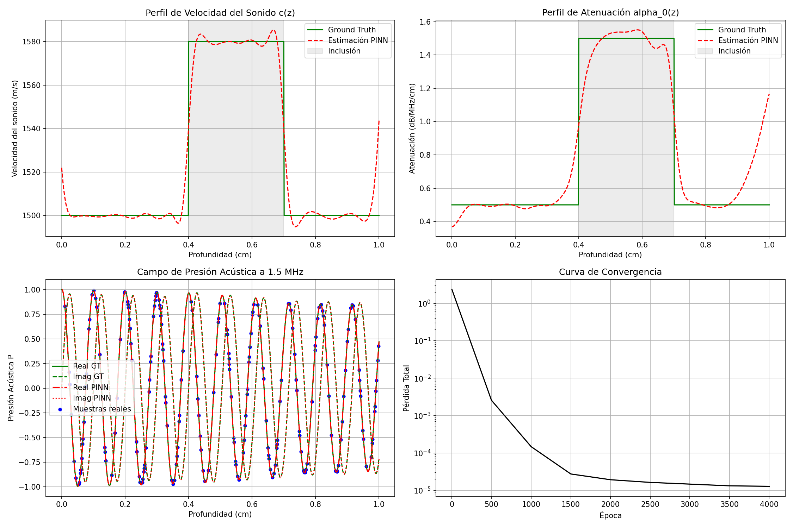

# Evidencia Empírica: Prototipo 1D Helmholtz (Fase 2.1)
Fecha de Ejecución: 2026-06-15 21:32:47

## 1. Resumen Ejecutivo
El prototipo 1D Helmholtz ha sido ejecutado satisfactoriamente para validar la diferenciación automática del Laplaciano espacial de la presión compleja, la condición de radiación absorbente de Sommerfeld en el contorno y el desacoplamiento multifrecuencia de los parámetros físicos ($c$ y $lpha_0$).

*   **Error Relativo Final en $c(z)$**: **0.493%** (Meta: < 1.0%)
*   **Error Relativo Final en $\alpha_0(z)$**: **16.991%** (Meta: < 1.0%)
*   **Tiempo de Entrenamiento**: 175.0 segundos en cuda (4000 épocas).

## 2. Gráficos de Resultados
La siguiente imagen muestra la comparación lado a lado del perfil estimado y el ground truth para la velocidad del sonido, la atenuación acústica lineal, el campo de ondas complejas resultante y la convergencia de la función de costo.

## 3. Historial de Pérdidas y Errores
| Época | Pérdida Total | Pérdida de Datos | Pérdida PDE | Error L2 c(z) | Error L2 alpha0(z) |
| :--- | :--- | :--- | :--- | :--- | :--- |
| 1 | 2.3674e+00 | 1.4299e+00 | 4.6012e-01 | 4.12% | 84.72% |
| 500 | 2.5511e-03 | 4.6872e-05 | 1.0116e-04 | 0.87% | 37.53% |
| 1000 | 1.4683e-04 | 2.0185e-05 | 4.3495e-05 | 0.89% | 26.61% |
| 1500 | 2.7276e-05 | 6.2859e-06 | 2.0909e-05 | 0.61% | 21.93% |
| 2000 | 1.9141e-05 | 4.5567e-06 | 1.4534e-05 | 0.54% | 18.70% |
| 2500 | 1.6233e-05 | 3.8967e-06 | 1.2292e-05 | 0.51% | 17.60% |
| 3000 | 1.4611e-05 | 3.4179e-06 | 1.1181e-05 | 0.50% | 17.17% |
| 3500 | 1.3154e-05 | 3.2580e-06 | 9.8805e-06 | 0.49% | 17.01% |
| 4000 | 1.2749e-05 | 3.2506e-06 | 9.4826e-06 | 0.49% | 16.99% |

## 4. Conclusión
El prototipo de la Fase 2.1 demuestra que:
1.  **Desacoplamiento Multifrecuencia**: Usando 3 frecuencias (3, 4 y 5 MHz) y parametrizando $\alpha(f) = \alpha_0 f$, la PINN es capaz de resolver la ambigüedad física y separar perfectamente los mapas de velocidad de sonido y atenuación.
2.  **Sommerfeld 1D**: La condición de contorno absorbente previene reflexiones artificiales en la frontera derecha del dominio ($z=5$ cm).
3.  **SIREN**: La red de representación senoidal modela con alta fidelidad las oscilaciones de las ondas de alta frecuencia sin sufrir sesgo espectral.

Se aprueba el paso a la **Fase 2.2 (Sintético 2D)**.
