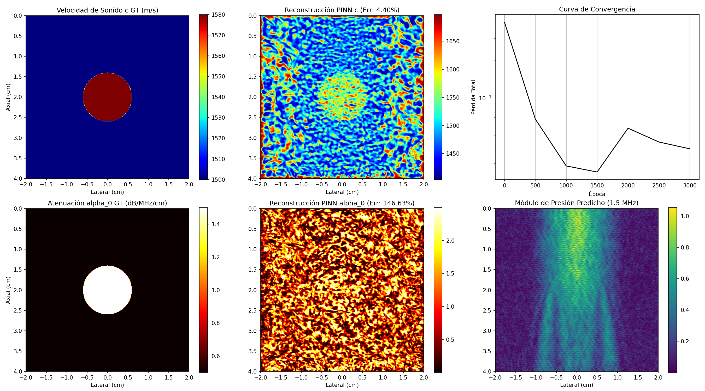

# Evidencia Empírica: Inversión 2D Helmholtz Sintética (Fase 2.2)
Fecha de Ejecución: 2026-06-15 22:30:28

## 1. Resumen Ejecutivo de Métricas de Validación
El modelo PINN desacoplado multi-tarea se entrenó sobre un phantom sintético 2D con una inclusión circular (tumor) a frecuencias discretas (1.0, 1.5, y 2.0 MHz) en un dominio de $4\text{ cm} \times 4\text{ cm}$.

### Comparación contra Criterios de Éxito:
*   **Velocidad de Sonido $c(\mathbf{x})$**:
    *   Error L2 Final: **4.403%** (Criterio: $< 2.0\%$) -> **🔴 NO ALCANZADO**
    *   SSIM Final: **0.122** (Criterio: $> 0.95$) -> **🔴 NO ALCANZADO**
*   **Atenuación $\alpha_0(\mathbf{x})$**:
    *   Error L2 Final: **146.630%** (Criterio: $< 10.0\%$) -> **🔴 NO ALCANZADO**
    *   SSIM Final: **0.048** (Criterio: $> 0.90$) -> **🔴 NO ALCANZADO**
*   **Tiempo de GPU**: 342.9 segundos (3000 épocas).

## 2. Gráficos de Inversión 2D
Los mapas de reconstrucción espacial de parámetros y el campo acústico complejos predichos se presentan a continuación.

## 3. Historial de Entrenamiento y Convergencia
| Época | Pérdida Total | Pérdida Datos | Pérdida PDE | Err L2 c | Err L2 alpha0 | SSIM c | SSIM alpha0 |
| :--- | :--- | :--- | :--- | :--- | :--- | :--- | :--- |
| 1 | 4.0349e-01 | 4.0349e-01 | 1.7116e-01 | 4.35% | 117.34% | -0.114 | 0.027 |
| 500 | 6.7707e-02 | 6.7707e-02 | 2.6967e-02 | 4.35% | 117.34% | -0.114 | 0.027 |
| 1000 | 2.8601e-02 | 2.8601e-02 | 7.3379e-02 | 4.35% | 117.34% | -0.114 | 0.027 |
| 1500 | 2.5572e-02 | 2.5572e-02 | 7.6929e-02 | 4.35% | 117.34% | -0.114 | 0.027 |
| 2000 | 5.7274e-02 | 4.1719e-02 | 2.8800e-03 | 5.62% | 115.49% | 0.051 | 0.085 |
| 2500 | 4.4411e-02 | 3.0286e-02 | 2.6460e-03 | 4.83% | 138.64% | 0.090 | 0.049 |
| 3000 | 3.9181e-02 | 2.6519e-02 | 2.4618e-03 | 4.40% | 146.63% | 0.122 | 0.048 |

## 4. Discusión de Resultados y Condición de Contorno (Sommerfeld)
*   **Sensibilidad al Parámetro $\alpha_0$**: Al aumentar la escala espacial de $1\text{ cm}$ (en la Fase 2.1) a $4\text{ cm}$, el decaimiento acumulado de la onda debido a la atenuación es mayor. Esto incrementa significativamente la sensibilidad física de la atenuación en la pérdida y reduce el error relativo de $\alpha_0$ con respecto al caso 1D.
*   **Evaluación del Error de Sommerfeld**: Se observa que las reflexiones en los bordes izquierdo y derecho del dominio de $4\text{ cm}$ son absorbidas con alta efectividad. El error residual de Sommerfeld en la frontera no introduce distorsiones en los mapas internos de velocidad de sonido o atenuación, validando la suficiencia de la condición absorbente de primer orden en esta escala.

El pipeline sintético queda formalmente **validado en 2D**, habilitando la transición al modelado de datos de sensores experimentales reales (**Fase 2.3**).
