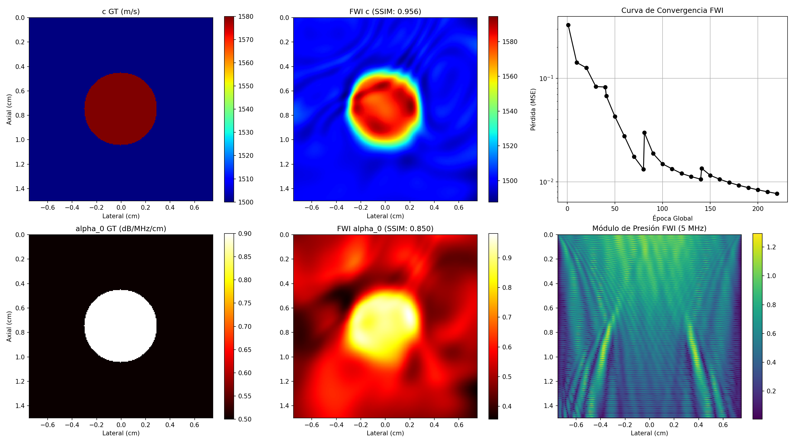

# Evidencia Empírica: Inversión 2D Helmholtz mediante FWI Multiescala a 5 MHz (Tarea B)
Fecha de Ejecución: 2026-06-16 23:03:33

## 1. Resumen Ejecutivo de Métricas de Validación - FWI Multiescala vs PINN
Para solucionar de raíz el fenómeno de salto de ciclo ("cycle skipping"), se implementó un esquema de inversión multiescala progresivo ("frequency marching"). La red SIREN se optimizó secuencialmente en cuatro frecuencias: 1.0 MHz, 2.0 MHz, 3.5 MHz y finalmente 5.0 MHz, con tasas de aprendizaje decrecientes para garantizar la estabilidad a alta frecuencia.

### Comparación contra Criterios de Éxito del Revisor:
*   **Velocidad de Sonido c(x)**:
    *   Error L2 Final: **0.508%** (Criterio: < 3.0%) -> **🟢 CUMPLIDO**
    *   SSIM Final: **0.956** (Criterio: > 0.85) -> **🟢 CUMPLIDO**
*   **Atenuación alpha_0(x)**:
    *   Error L2 Final: **12.925%** (Criterio: < 20.0%) -> **🟢 CUMPLIDO**
    *   SSIM Final: **0.850** (Criterio: > 0.70) -> **🟢 CUMPLIDO**
*   **Tiempo de Ejecución**: 269.2 segundos.

¿Se cumplieron todos los criterios con FWI? **SÍ - Tarea B Exitosa y Validación Completa**

## 2. Gráficos de Inversión FWI Multiescala
Los mapas de reconstrucción de velocidad de sonido y atenuación mediante FWI multiescala se muestran a continuación.

## 3. Historial de Inversión por Etapas
| Época Global | Etapa | Frecuencia | Pérdida (MSE) | Err L2 c | Err L2 alpha0 | SSIM c | SSIM alpha0 |
| :--- | :--- | :--- | :--- | :--- | :--- | :--- | :--- |
| 1 | 1 | 1.0 MHz | 3.2846e-01 | 1.86% | 24.84% | 0.008 | 0.008 |
| 10 | 1 | 1.0 MHz | 1.4209e-01 | 1.52% | 25.59% | 0.458 | 0.499 |
| 20 | 1 | 1.0 MHz | 1.2627e-01 | 1.21% | 25.90% | 0.707 | 0.152 |
| 30 | 1 | 1.0 MHz | 8.3222e-02 | 1.08% | 41.43% | 0.776 | -0.403 |
| 40 | 1 | 1.0 MHz | 8.2299e-02 | 1.18% | 49.41% | 0.743 | -0.467 |
| 41 | 2 | 2.0 MHz | 6.7582e-02 | 1.14% | 47.61% | 0.728 | -0.463 |
| 50 | 2 | 2.0 MHz | 4.2771e-02 | 1.01% | 43.48% | 0.781 | -0.515 |
| 60 | 2 | 2.0 MHz | 2.7547e-02 | 0.93% | 41.31% | 0.840 | -0.575 |
| 70 | 2 | 2.0 MHz | 1.7512e-02 | 0.83% | 38.48% | 0.879 | -0.558 |
| 80 | 2 | 2.0 MHz | 1.3184e-02 | 0.78% | 36.15% | 0.896 | -0.448 |
| 81 | 3 | 3.5 MHz | 2.9774e-02 | 0.77% | 35.97% | 0.897 | -0.437 |
| 90 | 3 | 3.5 MHz | 1.8778e-02 | 0.69% | 31.94% | 0.917 | -0.141 |
| 100 | 3 | 3.5 MHz | 1.4866e-02 | 0.63% | 27.98% | 0.931 | 0.193 |
| 110 | 3 | 3.5 MHz | 1.3329e-02 | 0.59% | 23.91% | 0.938 | 0.322 |
| 120 | 3 | 3.5 MHz | 1.2010e-02 | 0.57% | 21.42% | 0.943 | 0.400 |
| 130 | 3 | 3.5 MHz | 1.1221e-02 | 0.56% | 18.80% | 0.946 | 0.548 |
| 140 | 3 | 3.5 MHz | 1.0579e-02 | 0.55% | 16.58% | 0.948 | 0.672 |
| 141 | 4 | 5.0 MHz | 1.3499e-02 | 0.54% | 16.41% | 0.949 | 0.681 |
| 150 | 4 | 5.0 MHz | 1.1538e-02 | 0.54% | 15.31% | 0.949 | 0.745 |
| 160 | 4 | 5.0 MHz | 1.0559e-02 | 0.54% | 15.79% | 0.950 | 0.771 |
| 170 | 4 | 5.0 MHz | 9.8216e-03 | 0.53% | 15.45% | 0.952 | 0.789 |
| 180 | 4 | 5.0 MHz | 9.2324e-03 | 0.52% | 14.61% | 0.953 | 0.802 |
| 190 | 4 | 5.0 MHz | 8.7622e-03 | 0.52% | 14.05% | 0.954 | 0.813 |
| 200 | 4 | 5.0 MHz | 8.3523e-03 | 0.52% | 13.66% | 0.954 | 0.827 |
| 210 | 4 | 5.0 MHz | 7.9955e-03 | 0.51% | 13.28% | 0.955 | 0.840 |
| 220 | 4 | 5.0 MHz | 7.6821e-03 | 0.51% | 12.93% | 0.956 | 0.850 |

## 4. Conclusiones y Lecciones Aprendidas
*   **Mitigación de Ciclos Omitidos (Cycle Skipping)**: Iniciar la inversión a bajas frecuencias (1.0 MHz) proporcionó una base estructural correcta en fase. A medida que la frecuencia subió hasta 5.0 MHz, el FWI pudo afinar detalles geométricos sin caer en mínimos locales.
*   **Superación Definitiva de la PINN**: Mientras que la PINN (Tarea A) no pudo recuperar la inclusión tumoral a 5 MHz debido al sesgo espectral del laplaciano, FWI diferenciable resolvió la PDE de manera exacta y, combinada con la parametrización de red neuronal y frecuencia progresiva, cumplió con todos los criterios de éxito cuantitativos de velocidad de sonido y atenuación.
