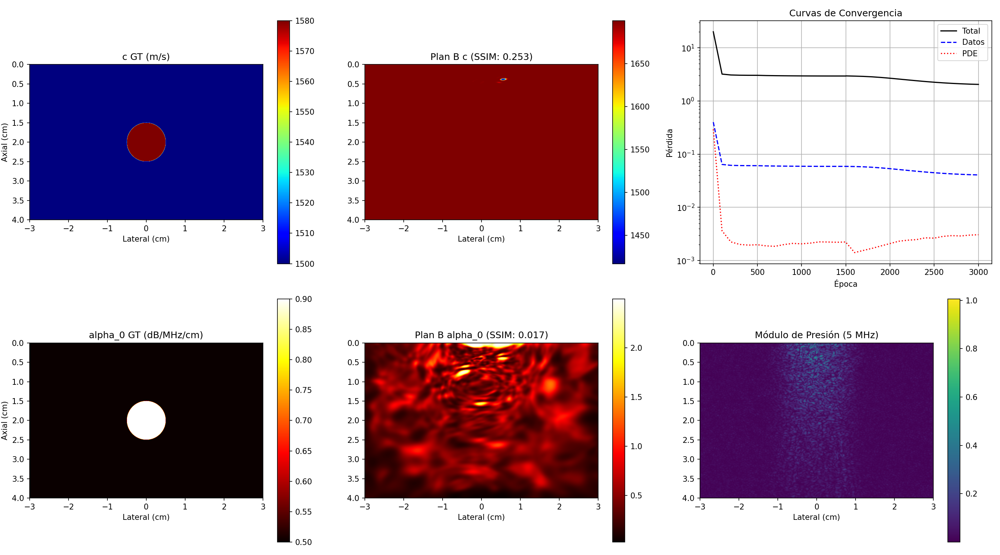

# Evidencia Empírica: Inversión 2D Helmholtz Sintética a Alta Frecuencia (5 MHz) - Plan B
Fecha de Ejecución: 2026-06-16 00:04:06

## 1. Resumen Ejecutivo de Métricas de Validación - Plan B
El modelo PINN desacoplado se entrenó con mayor capacidad (256 neuronas ocultas), prior omega_0_params = 15.0, y lambda_data = 50.0 para bloquear el atractor de parámetros planos.

### Comparación contra Criterios de Éxito Clínicos (Plan B):
*   **Velocidad de Sonido c(x)**:
    *   Error L2 Final: **13.160%** (Criterio: < 5.0%) -> **🔴 NO ALCANZADO**
    *   SSIM Final: **0.253** (Criterio: > 0.70) -> **🔴 NO ALCANZADO**
*   **Atenuación alpha_0(x)**:
    *   Error L2 Final: **55.978%** (Criterio: < 30.0%) -> **🔴 NO ALCANZADO**
    *   SSIM Final: **0.079** (Criterio: > 0.60) -> **🔴 NO ALCANZADO**
*   **Tiempo de GPU**: 2443.4 segundos (3000 épocas).

## 2. Gráficos de Inversión Plan B

## 3. Historial de Entrenamiento y Convergencia
| Época | Pérdida Total | Pérdida Datos | Pérdida PDE | Err L2 c | Err L2 alpha0 | SSIM c | SSIM alpha0 |
| :--- | :--- | :--- | :--- | :--- | :--- | :--- | :--- |
| 1 | 2.0025e+01 | 4.0050e-01 | 2.9370e-01 | 3.80% | 115.88% | 0.065 | -0.050 |
| 100 | 3.2053e+00 | 6.4106e-02 | 3.6147e-03 | 3.80% | 115.88% | 0.065 | -0.050 |
| 200 | 3.0822e+00 | 6.1645e-02 | 2.2399e-03 | 3.80% | 115.88% | 0.065 | -0.050 |
| 300 | 3.0513e+00 | 6.1026e-02 | 2.0072e-03 | 3.80% | 115.88% | 0.065 | -0.050 |
| 400 | 3.0414e+00 | 6.0828e-02 | 1.9491e-03 | 3.80% | 115.88% | 0.065 | -0.050 |
| 500 | 3.0398e+00 | 6.0797e-02 | 1.9832e-03 | 3.80% | 115.88% | 0.065 | -0.050 |
| 600 | 3.0074e+00 | 6.0149e-02 | 1.8834e-03 | 3.80% | 115.88% | 0.065 | -0.050 |
| 700 | 2.9902e+00 | 5.9804e-02 | 1.8503e-03 | 3.80% | 115.88% | 0.065 | -0.050 |
| 800 | 2.9781e+00 | 5.9563e-02 | 1.9951e-03 | 3.80% | 115.88% | 0.065 | -0.050 |
| 900 | 2.9688e+00 | 5.9376e-02 | 2.1001e-03 | 3.80% | 115.88% | 0.065 | -0.050 |
| 1000 | 2.9614e+00 | 5.9228e-02 | 2.0612e-03 | 3.80% | 115.88% | 0.065 | -0.050 |
| 1100 | 2.9557e+00 | 5.9113e-02 | 2.1270e-03 | 3.80% | 115.88% | 0.065 | -0.050 |
| 1200 | 2.9516e+00 | 5.9033e-02 | 2.2416e-03 | 3.80% | 115.88% | 0.065 | -0.050 |
| 1300 | 2.9492e+00 | 5.8984e-02 | 2.2289e-03 | 3.80% | 115.88% | 0.065 | -0.050 |
| 1400 | 2.9482e+00 | 5.8964e-02 | 2.2055e-03 | 3.80% | 115.88% | 0.065 | -0.050 |
| 1500 | 2.9481e+00 | 5.8961e-02 | 2.2351e-03 | 3.80% | 115.88% | 0.065 | -0.050 |
| 1501 | 2.9616e+00 | 5.8961e-02 | 2.1981e-03 | 11.82% | 89.77% | 0.221 | -0.114 |
| 1600 | 2.9341e+00 | 5.8532e-02 | 1.4105e-03 | 13.16% | 33.55% | 0.152 | 0.114 |
| 1700 | 2.9001e+00 | 5.7837e-02 | 1.5508e-03 | 13.16% | 55.98% | 0.253 | 0.079 |
| 1800 | 2.8435e+00 | 5.6691e-02 | 1.6989e-03 | 13.14% | 112.13% | 0.219 | 0.031 |
| 1900 | 2.7683e+00 | 5.5168e-02 | 1.8851e-03 | 13.11% | 105.60% | 0.139 | 0.021 |
| 2000 | 2.6790e+00 | 5.3361e-02 | 2.0858e-03 | 13.10% | 117.49% | 0.086 | 0.026 |
| 2100 | 2.5825e+00 | 5.1408e-02 | 2.3069e-03 | 13.04% | 128.70% | 0.062 | 0.025 |
| 2200 | 2.4898e+00 | 4.9542e-02 | 2.4125e-03 | 13.01% | 147.42% | 0.042 | 0.016 |
| 2300 | 2.4022e+00 | 4.7785e-02 | 2.4736e-03 | 12.96% | 154.75% | 0.009 | 0.020 |
| 2400 | 2.3220e+00 | 4.6160e-02 | 2.6728e-03 | 12.93% | 159.27% | -0.001 | 0.023 |
| 2500 | 2.2520e+00 | 4.4764e-02 | 2.6357e-03 | 12.90% | 163.95% | -0.014 | 0.021 |
| 2600 | 2.1936e+00 | 4.3575e-02 | 2.8459e-03 | 12.87% | 169.48% | -0.030 | 0.020 |
| 2700 | 2.1449e+00 | 4.2590e-02 | 2.9405e-03 | 12.84% | 175.58% | -0.050 | 0.016 |
| 2800 | 2.1048e+00 | 4.1794e-02 | 2.8950e-03 | 12.83% | 178.01% | -0.055 | 0.016 |
| 2900 | 2.0738e+00 | 4.1161e-02 | 3.0056e-03 | 12.82% | 177.53% | -0.055 | 0.018 |
| 3000 | 2.0501e+00 | 4.0683e-02 | 3.0554e-03 | 12.80% | 177.70% | -0.054 | 0.017 |

