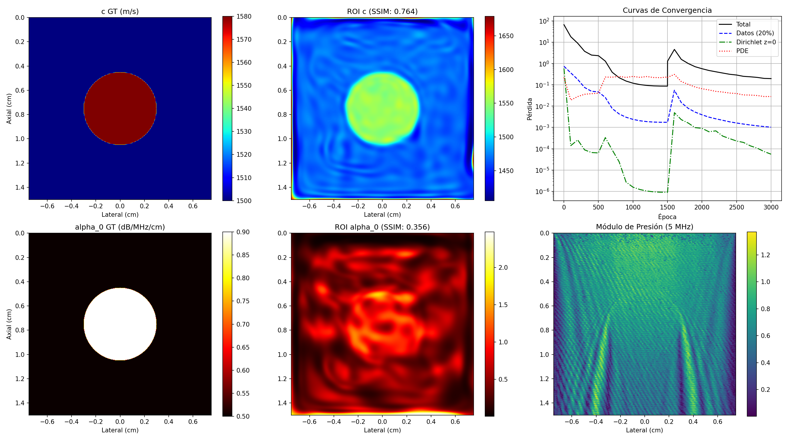

# Evidencia Empírica: Inversión 2D Helmholtz en ROI Pequeña (1.5 cm x 1.5 cm) a 5 MHz
Fecha de Ejecución: 2026-06-16 22:27:52

## 1. Resumen Ejecutivo de Métricas de Validación - ROI Pequeña
El modelo PINN desacoplado se entrenó en una región de interés (ROI) pequeña de 1.5 cm x 1.5 cm centrada en la inclusión, utilizando $\omega_{0,\text{params}} = 5.0$ y un sensor Dirichlet explícito en la superficie ($z=0$).

### Comparación contra Criterios de Éxito del Revisor:
*   **Velocidad de Sonido c(x)**:
    *   Error L2 Final: **2.601%** (Criterio: < 3.0%) -> **🟢 CUMPLIDO**
    *   SSIM Final: **0.764** (Criterio: > 0.85) -> **🔴 NO ALCANZADO**
*   **Atenuación alpha_0(x)**:
    *   Error L2 Final: **53.690%** (Criterio: < 20.0%) -> **🔴 NO ALCANZADO**
    *   SSIM Final: **0.356** (Criterio: > 0.70) -> **🔴 NO ALCANZADO**
*   **Tiempo de GPU**: 272.0 segundos (3000 épocas).

¿Se cumplieron todos los criterios? **NO - Tarea A Fallida**

## 2. Gráficos de Inversión en la ROI

## 3. Historial de Entrenamiento y Convergencia
| Época | Pérdida Total | Pérdida Datos | Pérdida PDE | Err L2 c | Err L2 alpha0 | SSIM c | SSIM alpha0 |
| :--- | :--- | :--- | :--- | :--- | :--- | :--- | :--- |
| 1 | 6.6830e+01 | 7.4598e-01 | 2.2167e-01 | 4.35% | 147.67% | 0.056 | -0.042 |
| 100 | 1.8224e+01 | 3.6434e-01 | 1.9225e-02 | 4.35% | 147.67% | 0.056 | -0.042 |
| 200 | 9.0176e+00 | 1.8009e-01 | 2.8143e-02 | 4.35% | 147.67% | 0.056 | -0.042 |
| 300 | 3.7591e+00 | 7.5094e-02 | 3.6073e-02 | 4.35% | 147.67% | 0.056 | -0.042 |
| 400 | 2.5013e+00 | 4.9960e-02 | 3.8555e-02 | 4.35% | 147.67% | 0.056 | -0.042 |
| 500 | 2.3395e+00 | 4.6727e-02 | 4.0214e-02 | 4.35% | 147.67% | 0.056 | -0.042 |
| 600 | 1.2976e+00 | 2.5617e-02 | 2.3135e-01 | 4.35% | 147.67% | 0.056 | -0.042 |
| 700 | 3.8871e-01 | 7.6868e-03 | 2.2983e-01 | 4.35% | 147.67% | 0.056 | -0.042 |
| 800 | 2.1635e-01 | 4.3026e-03 | 2.4852e-01 | 4.35% | 147.67% | 0.056 | -0.042 |
| 900 | 1.5086e-01 | 3.0145e-03 | 2.2371e-01 | 4.35% | 147.67% | 0.056 | -0.042 |
| 1000 | 1.1977e-01 | 2.3938e-03 | 2.4857e-01 | 4.35% | 147.67% | 0.056 | -0.042 |
| 1100 | 1.0306e-01 | 2.0601e-03 | 2.2525e-01 | 4.35% | 147.67% | 0.056 | -0.042 |
| 1200 | 9.3944e-02 | 1.8778e-03 | 2.4554e-01 | 4.35% | 147.67% | 0.056 | -0.042 |
| 1300 | 8.9370e-02 | 1.7865e-03 | 2.2144e-01 | 4.35% | 147.67% | 0.056 | -0.042 |
| 1400 | 8.7627e-02 | 1.7516e-03 | 2.1724e-01 | 4.35% | 147.67% | 0.056 | -0.042 |
| 1500 | 8.7360e-02 | 1.7463e-03 | 2.3516e-01 | 4.35% | 147.67% | 0.056 | -0.042 |
| 1501 | 1.2898e+00 | 1.7463e-03 | 2.2460e-01 | 5.50% | 172.48% | -0.206 | -0.006 |
| 1600 | 4.6095e+00 | 5.5924e-02 | 3.0911e-01 | 4.94% | 87.85% | 0.435 | 0.147 |
| 1700 | 1.5736e+00 | 1.4687e-02 | 1.4310e-01 | 4.01% | 50.92% | 0.597 | 0.341 |
| 1800 | 1.0078e+00 | 7.8984e-03 | 1.0553e-01 | 3.61% | 49.16% | 0.661 | 0.372 |
| 1900 | 7.1179e-01 | 5.2478e-03 | 7.9461e-02 | 3.46% | 49.45% | 0.704 | 0.385 |
| 2000 | 5.7217e-01 | 3.9166e-03 | 6.5634e-02 | 3.23% | 51.91% | 0.685 | 0.362 |
| 2100 | 4.7334e-01 | 3.0460e-03 | 5.7546e-02 | 3.15% | 53.12% | 0.675 | 0.377 |
| 2200 | 4.1098e-01 | 2.5441e-03 | 4.9472e-02 | 3.00% | 50.28% | 0.728 | 0.402 |
| 2300 | 3.5858e-01 | 2.1621e-03 | 4.5860e-02 | 2.85% | 53.77% | 0.732 | 0.356 |
| 2400 | 3.1398e-01 | 1.8368e-03 | 4.1162e-02 | 2.84% | 52.83% | 0.747 | 0.374 |
| 2500 | 2.8953e-01 | 1.6169e-03 | 3.9157e-02 | 2.82% | 54.60% | 0.707 | 0.354 |
| 2600 | 2.5112e-01 | 1.4425e-03 | 3.3600e-02 | 2.74% | 53.09% | 0.752 | 0.379 |
| 2700 | 2.3880e-01 | 1.3017e-03 | 3.3163e-02 | 2.68% | 55.12% | 0.735 | 0.346 |
| 2800 | 2.2357e-01 | 1.1908e-03 | 3.1541e-02 | 2.63% | 53.77% | 0.750 | 0.365 |
| 2900 | 2.0088e-01 | 1.0970e-03 | 2.8278e-02 | 2.58% | 54.26% | 0.739 | 0.351 |
| 3000 | 1.9664e-01 | 1.0284e-03 | 2.8307e-02 | 2.60% | 53.69% | 0.764 | 0.356 |

